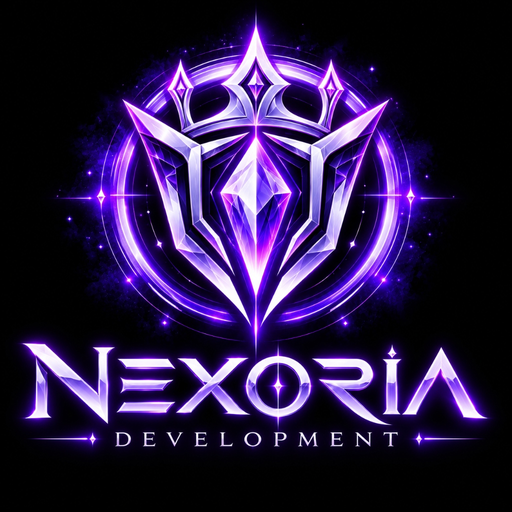

<p align="center">
  <picture>
    
  </picture>
</p>

<h1 align="center">ND Chat</h1>

<p align="center">
  <b>The official real-time messaging, voice, and community platform for Nexoria Development.</b>
</p>

<p align="center">
  <a href="https://github.com/nexiorachat/ndchat/releases/latest">
    
  </a>
  <a href="https://chat.nexoriadevelopment.com">
    
  </a>
  <a href="./LICENSE">
    
  </a>
</p>

---

## 🚀 About ND Chat

ND Chat is a high-performance, self-hosted instant messaging and VoIP platform built for friends, teams, and gaming communities powered by Nexoria Development.

- 🌐 **Web Client:** [chat.nexoriadevelopment.com](https://chat.nexoriadevelopment.com)
- 🖥️ **Desktop App:** [Download Latest Windows Release](https://github.com/nexiorachat/ndchat/releases/latest)
- 🔒 **Authentication:** Direct username & password login, secure sessions, and passkey support.

---

## 💻 Download & Access

### Desktop App (Windows)
Download the standalone installer or executable directly from the repository releases:
- ⬇️ **[Latest ND Chat Windows Installer (.exe)](https://github.com/nexiorachat/ndchat/releases/latest)**

### Web Client
No installation required — access ND Chat instantly from any modern web browser:
- 🌐 **[chat.nexoriadevelopment.com](https://chat.nexoriadevelopment.com)**

---

## 🛠️ Self-Hosting & Architecture

ND Chat runs on a containerized microservice architecture managed with Docker Compose.

### Server Stack Overview
- **App & Proxy:** `fluxer-app-proxy-self-hosted` (React SPA + Rust proxy)
- **API Backend:** Node.js / TypeScript microservices
- **Gateway & Voice:** High-throughput WebSocket gateway + LiveKit SFU
- **Storage & Cache:** PostgreSQL, Valkey / Redis, Meilisearch, SeaweedFS
- **Reverse Proxy:** Caddy with automatic SSL certificates

### Quick Update Command
To apply new updates to your server instance:
```bash
cd ~/fluxer-instance
sh install.sh --update --allow-root
```

---

## 📜 License & Acknowledgments

- **Software License:** Licensed under the [GNU Affero General Public License v3.0 (AGPL-3.0-or-later)](./LICENSE).
- **Branding & Assets:** Nexoria Development artwork, crests, logos, and custom branding are copyright © Nexoria Development.
- **Upstream:** Built on the open-source [Fluxer](https://github.com/fluxerapp/fluxer) architecture with custom Nexoria branding, identity integration, and client optimizations.
